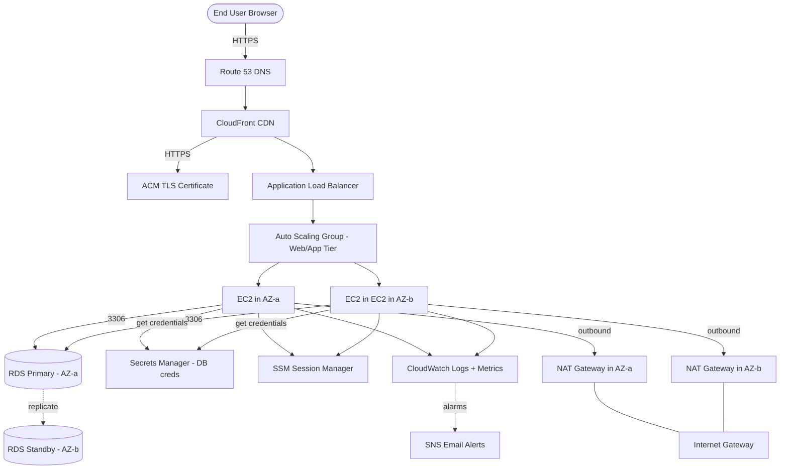

# Project 1: Highly Available 3-Tier Web Application on AWS
**Author:** Muhammad Tayyab
**Mentor mode:** Senior AWS DevOps Architect
**Skill focus:** Networking, High Availability, Scaling

---

## PART 1 of 7 — Business Problem, Architecture, and Prerequisites

---

### 1. Business Problem

**The problem this project solves:**

Small and mid-size companies lose money when their website goes down. A single EC2 instance in one Availability Zone (AZ) can fail. A database with no replica can lose customer orders. A website with no CDN is slow for users far from the server. A site with no HTTPS loses trust and SEO ranking.

**What "highly available 3-tier" means in business terms:**

| Tier | What it does | Failure we protect against |
|------|--------------|----------------------------|
| Web/App | Runs the user-facing code (Flask/Node) | If one EC2 dies, another takes over. If one AZ dies, the other serves traffic. |
| Database | Stores user data (MySQL/PostgreSQL) | If the primary DB fails, a standby in another AZ is promoted automatically. |
| Edge/DNS | Delivers content fast and routes users | Traffic is spread, cached at the edge, and served over HTTPS. |

**Target outcomes you can put on a resume:**

- 99.95% monthly availability target
- Tolerate loss of one AZ with no user-visible downtime
- Auto-heal unhealthy instances in under 5 minutes
- Serve users globally with low latency over HTTPS
- No SSH keys on instances (SSM Session Manager)

---

### 2. Architecture Diagram

#### Mermaid diagram



#### ASCII diagram (for the README)

```
                    [ End User ]
                         |
                         v  HTTPS
                   [ Route 53 ]
                         |
                         v
                 [ CloudFront CDN ]
                  (ACM TLS cert)
                         |
                         v
               [ Application Load Balancer ]
                  (public subnets, both AZs)
                  /                              \
                 v                                v
        [ EC2 web/app ]                   [ EC2 web/app ]
        (private-app AZ-a)                (private-app AZ-b)
        [ Auto Scaling Group - min 2, max 4 ]
                 \                              /
                  v                            v
                  [ RDS MySQL Primary - AZ-a ]
                  [ RDS MySQL Standby - AZ-b ]   (Multi-AZ sync)
                         ^
                         |
            [ Secrets Manager - DB creds ]
```

#### Component explanations

| # | Component | Purpose | Why it matters |
|---|-----------|---------|----------------|
| 1 | **Custom VPC** | Your own isolated network in AWS | No IP conflicts with other AWS users, full control over routing |
| 2 | **Public subnets (2)** | Hold the ALB | ALB must face the internet to receive user traffic |
| 3 | **Private-app subnets (2)** | Hold EC2 instances | EC2 has no public IP; safer, no direct internet exposure |
| 4 | **Private-DB subnets (2)** | Hold RDS | Database never on the public internet |
| 5 | **Internet Gateway (IGW)** | Outbound path for public subnets | Required for the ALB to talk to the internet |
| 6 | **NAT Gateway (1 or 2)** | Outbound internet for private subnets | EC2 needs internet for OS updates, package installs |
| 7 | **Route Tables** | Decide where traffic goes | One public RT, one private RT (or two for HA NAT) |
| 8 | **Application Load Balancer (ALB)** | HTTP/HTTPS layer-7 load balancer | Health checks, SSL termination, distributes across AZs |
| 9 | **Auto Scaling Group (ASG)** | Keeps N healthy EC2 instances running | Self-heals, scales up on CPU, scales down when idle |
| 10 | **Launch Template** | EC2 blueprint (AMI, type, user data, SG) | ASG uses this to launch identical instances |
| 11 | **RDS Multi-AZ** | Managed MySQL/Postgres with standby | Automatic failover, automated backups, managed patching |
| 12 | **Secrets Manager** | Stores DB username/password | EC2 reads creds on boot, no hardcoded secrets |
| 13 | **CloudFront** | Global CDN in front of ALB | Caches at edge, faster for distant users, free HTTPS |
| 14 | **Route 53** | DNS service | Points your domain (or test domain) to CloudFront/ALB |
| 15 | **ACM** | Free TLS certificate | Required for HTTPS on ALB or CloudFront |
| 16 | **CloudWatch** | Metrics, logs, dashboards | Centralized observability |
| 17 | **SNS** | Email topic for alerts | You get pinged when something breaks |
| 18 | **SSM Session Manager** | Browser-based shell into EC2 | No SSH, no public IP, no key pairs |
| 19 | **Security Groups** | Instance-level firewall | Least-privilege inbound rules |
| 20 | **IAM Role for EC2** | Lets EC2 call AWS APIs | Needed for SSM, CloudWatch, Secrets Manager |

---

### 3. Prerequisites

Complete every item below before you start. If you skip, you will get stuck.

#### 3.1 AWS account

- Sign in to https://console.aws.amazon.com as the **root user** only to create an IAM admin user, then use that user.
- Enable **MFA** on the root account.
- Make sure the region in the top-right is one you want to use. Recommended: **us-east-1 (N. Virginia)** because it has the most services and free tier coverage. Substitute your region in every step.

#### 3.2 IAM admin user (console access)

1. AWS Console -> search bar -> type **IAM** -> click **IAM**.
2. Left menu -> **Users** -> **Create user**.
3. Username: `tayyab-admin`.
4. Check **Provide user access to the AWS Management Console**.
5. Select **I want to create an IAM user**.
6. Set a strong password. Uncheck "Users must create a new password at next sign-in" (you're a sandbox).
7. **Next**.
8. **Attach policies directly** -> search `AdministratorAccess` -> check **AdministratorAccess**.
9. **Next** -> **Create user**.
10. Click the user -> **Create access key** -> **Command Line Interface** -> check "I understand..." -> **Next** -> save the **Access key ID** and **Secret access key** somewhere safe (password manager).

**Verify:** You can sign out of root and sign in as `tayyab-admin`. You see the same console.

#### 3.3 AWS CLI (for the Terraform and verification parts)

1. Install: `pip install awscli` or use the AWS CLI v2 MSI/Linux bundle from https://awscli.amazonaws.com.
2. `aws --version` -> should print a version.
3. `aws configure`:
   - AWS Access Key ID: (paste)
   - AWS Secret Access Key: (paste)
   - Default region: `us-east-1`
   - Default output format: `json`
4. Verify: `aws sts get-caller-identity` -> prints your user ARN.

#### 3.4 Terraform

1. Install Terraform 1.5+ from https://developer.hashicorp.com/terraform/install.
2. `terraform -version` -> shows version.

#### 3.5 A registered domain (optional but recommended)

- If you have a domain in Route 53, great. If not, you can buy one (~12 USD/yr) or skip the Route 53 section and just use the ALB's default DNS name to test.

#### 3.6 An email you can receive alerts on

- You'll subscribe to an SNS topic for CloudWatch alarms.

#### 3.7 Local tools

- A text editor (VS Code).
- A terminal (bash, zsh, PowerShell).
- Git installed (`git --version`).

#### 3.8 Skill prerequisites

You should already know (from your Jenkins/EC2/ECS/EKS projects):
- How to launch an EC2 instance
- How to use SSH into EC2 (you'll switch to SSM in this project)
- Basic Linux: `cd`, `ls`, `cat`, `systemctl`, `curl`, `sudo`
- YAML/JSON basics
- Docker basics (for the sample app)

#### 3.9 Cost awareness (READ THIS)

These resources **cost money** if left running:

| Resource | Approx cost (us-east-1) | Free tier? |
|----------|------------------------|------------|
| NAT Gateway (1) | ~$0.045/hr = ~$32/month | No |
| NAT Gateway (2) | ~$64/month | No |
| ALB | ~$0.0225/hr = ~$16/month + LCU charges | First 750 hrs/month free for 12 months |
| RDS db.t3.micro Multi-AZ | ~$0.068/hr = ~$25/month each AZ = ~$50/month | First 750 hrs single-AZ free; Multi-AZ is NOT free |
| EC2 t3.micro | ~$0.0104/hr = ~$8/month each | 750 hrs/month free for 12 months |
| CloudWatch metrics, logs, dashboards | Often under $5/month | Some free |
| Secrets Manager | $0.40/secret/month | No |
| Data transfer | Variable | Some free |

**Realistic total for a sandbox you run for 1 month: $80-$150.**
**For 1 week: $25-$40.**
You will get a cleanup section in Part 6. Run the cleanup the day you finish.

---

**Say "continue" to receive Part 2:** Complete GUI tutorial — VPC, subnets, gateways, route tables.

